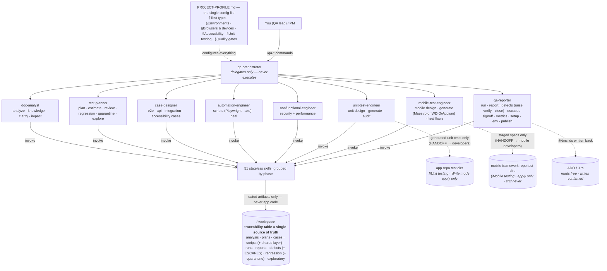
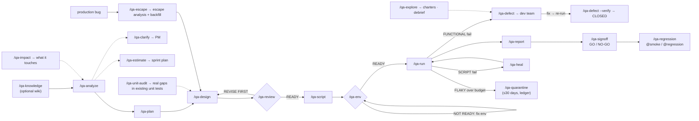

# agentic-fx-qa

**v2.5.0** ([changelog](CHANGELOG.md) · [upgrading](UPGRADE.md)) · MIT · runs in **Claude Code**

A **testing-only** agentic QA workflow for Claude Code. One pipeline takes a feature from raw
docs to a signed-off report, across **ten test types — unit, API, integration, functional E2E,
security, performance, accessibility, visual & layout UI, mobile, data pipelines** — on every **platform** the product
ships on (web, Android, iOS, Windows, macOS, API, or your own) — with every project-specific value read from a single
config file, and the whole STLC around it: defect lifecycle, quarantine, escaped-defect intake,
exploratory sessions, release sign-off, portfolio metrics, CI.

It does QA, not development: application source is read-only grounding; the bundle never edits
product code. The two deliberate, narrow exceptions are the `unit` and `mobile` types: generated
unit tests and WebdriverIO/Appium specs are staged in `<qa-root>/` and handed to developers through a
`HANDOFF.md`, and land in the declared test directories of the app repo / the mobile framework repo
only when the profile says `apply` — never in production paths, never in the framework's `src/`.

```
raw docs ──/qa-knowledge──▶ <qa-root>/wiki/ — compiled domain wiki (glossary, personas, BR-### rules), optional
story    ──/qa-impact─────▶ what it touches: BRs · modules/code (cited @ commit) · cases to re-verify · gaps, optional
tests ──/qa-import──▶ an existing suite, counted: cases from every tool, duplicates, weak steps, script links  (start here when tests exist)
docs ──/qa-analyze──▶ requirements (REQ-ids) + per-type testability matrix + risks   (docs, URLs, Jira keys)
     ──/qa-plan─────▶ strategy + test plan + the traceability table (source of truth)
     ──/qa-design───▶ test cases per enabled type   (--type unit|api|integration|e2e|security|performance|accessibility|ui|mobile|all)
     ──/qa-script───▶ automation, mirrors cases 1:1  (Playwright / axe / k6 / ZAP / the repo's own unit framework → HANDOFF / WDIO+Appium → HANDOFF)
     ──/qa-run──────▶ execute per type, record runs, update traceability  (never auto-fixes; quarantined cases still run)
     ──/qa-run --plan <name> ▶ execute a saved RUN PLAN (<qa-root>/run-plans/<name>.md): any mix of features × types, locally or in CI
     ──/qa-report───▶ per-type summary + quality-gate verdicts + SLO / security / a11y / coverage tables
   support:  /qa-status   /qa-heal   /qa-publish (ADO · Jira)   /qa-upload (→ verdict)   /qa-help
   lead layer:  /qa-clarify  /qa-estimate  (after analyze)  ·  /qa-review  (before script)  ·  /qa-setup  (once per machine)  ·  /qa-env  (before run)
                /qa-defect (raise · --verify · close)  /qa-quarantine  /qa-escape  /qa-explore  (after runs / from production)
                /qa-signoff  /qa-metrics  /qa-coverage  /qa-regression  (release & portfolio)  ·  /qa-run-plan  (build run plans once, then trigger)
   team:       /qa-review-pr <n|branch>  (a teammate's testing PR/MR, GitLab or GitHub: tests that lie → APPROVE / REQUEST CHANGES)
   code tier:  /qa-unit-audit  (audit the repo's existing unit tests: gaps · smells · mutation sensitivity → feeds /qa-design --type unit)
   recall:     /qa-retro  (where the process leaked, as patterns, each action with a mechanism)  →  /qa-improve  (one earned check + two fixtures)
   from dev:   /qa-analyze <slug> dev/release/<slug>/qa-handoff.md   (the agentic-fx-dev G9 packet: REQ ids kept, automation-tier list = scope)
```

**Coming in 2.1** ([Unreleased](CHANGELOG.md#unreleased)):
- **Maestro** runs mobile flows from `<qa-root>/`.
- **`## Grounding`** makes every case cite the business rule, wiki page or code it was designed
  from. Lint opens each citation, and `/qa-review` fails P0/P1 cases that cite nothing.
- **One `<qa-root>/_templates/` folder** holds every format.
- **Front matter** goes on every authored artifact.
- **A runner registry**: adding Selenium, Cypress or Detox is one entry and one wrapper script.

New rules warn in 2.1.x and 2.2.x. **The QA root** is `.stlc/` in a new project and `qa/` in an
older one; both work, and `migrate-root.mjs` moves between them ([UPGRADE.md](UPGRADE.md#220-minor-from-21)).

> **New here?** Read the [user guide](docs/user-guide.md) — a real session end to end, what the
> artifacts look like, every stop and what to do about it, and your week once it is running.
> This README is the reference; `/qa-help` is the command map.

## What's inside

| Part | Count | Purpose |
|---|---|---|
| `PROJECT-PROFILE.md` | 1 | **The single config file** — app under test, test types, platforms, environments, browsers, accessibility target, UI testing, unit tier, quality gates, TMS |
| `CONTRACTS.md` | 1 | **The single source of truth for cross-file contracts** — ids, paths, table columns, triage vocabulary, tag writers, quarantine, defect lifecycle, exploratory sheets; enforced by `npm run qa:lint` |
| `agents/` | 10 | qa-orchestrator (entry point, delegates only) + doc-analyst, test-planner, case-designer, automation-engineer, nonfunctional-engineer (perf+security), unit-test-engineer, mobile-test-engineer, data-test-engineer (ELT pipelines), qa-reporter |
| `commands/` | 37 | existing suite: `/qa-import` · pipeline: `/qa-knowledge` `/qa-analyze` `/qa-plan` `/qa-design` `/qa-script` `/qa-run` `/qa-run-plan` `/qa-ingest` `/qa-report` · support: `/qa-status` `/qa-heal` `/qa-publish` `/qa-upload` `/qa-help` `/qa-feedback` · team: `/qa-review-pr` · lead layer: `/qa-impact` `/qa-clarify` `/qa-estimate` `/qa-review` `/qa-setup` `/qa-env` `/qa-defect` `/qa-quarantine` `/qa-escape` `/qa-explore` `/qa-signoff` `/qa-metrics` `/qa-coverage` `/qa-regression` · code tier: `/qa-unit-audit` · recall: `/qa-retro` `/qa-improve` `/qa-learn` `/qa-flaky` `/qa-triage` |
| `skills/` | 54 | `qa-phase-protocol` (the procedure every command shares, loaded once per session) + domain-wiki, analysis, planning, 10 case-design (incl. unit matrices, WCAG 2.2 AA, visual & layout UI, mobile device reality, data pipeline hops), 9 script-gen (incl. dbt and PySpark data tests, unit in xUnit/Vitest/pytest/JUnit, axe-core, visual baselines + layout checks, Maestro flows or WebdriverIO/Appium; locators verified live when `playwright-cli` is installed), execute, report, heal (e2e specs and Maestro flows), placement, publish (ADO + Jira) + lead layer: CI ingest, clarifications, estimation, case-review, testing-PR review, unit-test audit, env-check, defect lifecycle, escaped-defect analysis, exploratory sessions, machine setup, release sign-off, metrics, regression + quarantine, run plans, test-data, retrospectives, improving-checks, lessons across runs (gated, recalled by later skills), flaky hunts (repeat runs, heal guard) + knowledge: code grounding, impact map — ideas adapted from public skills are recorded in [`docs/skill-sources.md`](docs/skill-sources.md) |
| `workspace/qa/` | scaffold | Fixed folder layout + `package.json`, `playwright.config.ts` (browser projects, junit), `eslint.config.mjs`, **shipped shared layer** (`scripts/shared/`: API client + auth, poll, fixtures, DB client, OpenAPI validator, base page, axe helper, timeouts), `ci/` templates (GitLab · GitHub), `.env.example`, `docs/tag-taxonomy.md`, `docs/impact-map.md`, ledgers (`regression/quarantine.md`, `defects/ESCAPES.md`), exploratory template, gated ZAP runner, unit runner wrapper + coverage parser + `scripts/unit/HANDOFF.md`, mobile runners (Maestro: `scripts/mobile/run-maestro.mjs` + the `scripts/shared/maestro/` kit; Appium: the wrapper + `scripts/mobile/HANDOFF.md`), report template, `wiki/` seed |
| `tests/` | self-check | `tests/selfcheck.sh` + reference fixture — the shipped lint must accept it and reject every contract violation it lists (platforms and ui included); `tests/bundle.test.mjs` — the bundle lints itself (names, context budgets, wiring, `§` citations, README counts); `tests/build-state.test.mjs` — the `§17` derivation and its hooks. All run in the bundle's own CI, with the extension build |
| `CONTRACTS.md §16` | the dev seam | the report and sign-off shape `agentic-fx-dev` parses at its deploy gate — front matter, byte-exact headings and the `\| Gate \| Target \| Actual \| Verdict \| Evidence \|` table, with `overall` derived from the rows and enforced by `qa:lint` |

## The ten test types

| Type | Cases from | Scripts (default) | Gate |
|---|---|---|---|
| **unit** | logic-bearing symbols behind P0/P1 REQs and BRs, grounded to code at a commit; test matrix = partitions · boundary triples · decision tables · state transitions · exception contracts · mutation guards | the repo's own framework (xUnit/NUnit · Vitest/Jest · pytest · JUnit 5), staged in `<qa-root>/scripts/unit/` → `HANDOFF.md` → repo test dir (`propose` default / `apply`) | 0 failing; branch/line coverage on impacted modules ≥ §Unit testing thresholds; every logic-bearing P0/P1 REQ has a case; hermetic (no I/O/clock/random) |
| **api** | OpenAPI + requirements + endpoint-class heuristics (list/filter matrix, PATCH semantics, state machines, idempotency, async, bulk, tenant isolation, error contract, contract drift) | Playwright API tier (alt pytest) — schema assertions compiled from the spec (`expectSchema`), table-driven rows with per-row `assert` | contract + CRUD + negatives + authz + endpoint classes; 0 failing P0/P1 |
| **integration** | declared service/DB seams | Playwright API + read-only parameterised DB assertions | each seam covered; API-action → DB-state verified |
| **e2e** | P0/P1 user flows | Playwright + TypeScript, page objects on `BasePage` | grounded locators (registry → testid → role); 0 failing P0/P1 |
| **security** | OWASP Top 10 + authz matrix | ZAP baseline + Playwright authz specs | 0 unresolved High/Critical; **own app, authorized envs only** |
| **performance** | key transactions | k6 (alt Locust) | p95/error SLOs encoded as k6 thresholds → run fails the gate automatically |
| **accessibility** | screen × state inventory (from e2e journeys + element registry) against WCAG 2.2 AA; keyboard / focus / validation / reflow cases; `@manual` for what a machine cannot hear | Playwright + axe-core (`expectNoA11yViolations`, `expectTabOrder`) | 0 unresolved Critical/High findings; manual cases executed in `/qa-explore` sessions |
| **ui** (visual & layout) | screen × state (empty · loading · error · populated · long data · permission-limited) × viewport (320 · 768 · 1280) × platform; masks with reasons; layout rules | Playwright `toHaveScreenshot` (`expectVisual`, per OS × project baselines generated in the CI image) + pixel-free layout checks (`expectNoHorizontalScroll`, `expectNoOverflow`, `expectNoOverlap`, `expectTouchTargets`, tokens) | 0 failing P0/P1 on gate-tier projects; every baseline change reviewed |
| **mobile** (off by default) | one journey for both platforms + the device reality: interrupts, background/foreground, offline + flaky network, permissions, orientation, deep links, WebView, biometrics, kill/relaunch; `## Platforms` + `## Device profile` on every case | **Maestro** flows run from `<qa-root>/` on the shipped kit (`<qa-root>/scripts/shared/maestro/`: element maps, sign-in, network, data factory, cleanup) — or the mobile automation repo's own framework (Appium 2 + WebdriverIO — the agentic-fx `mobilewright-automation` template), specs staged in `<qa-root>/scripts/mobile/` → `HANDOFF.md` → framework test dir; framework `src/` never edited (`FRAMEWORK-GAP`s handed over) | 0 failing P0/P1 on every gate-tier device per platform; P0 journeys on both platforms; 0 crashes/ANRs |
| **data** (off by default) | ELT/ETL pipelines: reconciliation per layer hop (counts, keys, sums, row hash, conservation), transformation unit rows, business rules, PII shape, schema drift, freshness, incremental drills (idempotent re-run, late data, backfill); `## Hop` + `## Oracle` + `## Tolerance` on every case; readiness R1–R8 before any design | the pipeline repo's own framework (dbt tests on a CI engine such as DuckDB, PySpark + pytest — the agentic-fx `dbt-elt` / `spack-elt` templates), tests staged in `<qa-root>/scripts/data/` → `HANDOFF.md` → pipeline test dir; models and jobs never edited | 0 failing P0/P1 checks; every planted mutant caught on the same commit; no run counts without a result file |

## Platforms — where each case runs

A test type says WHAT a case proves; a **platform** says WHERE it runs (`CONTRACTS §20`). PROJECT-PROFILE
`## Platforms` lists them — `web` (browser targets), `android`/`ios` (Appium, staged + handoff),
`windows`/`macos` (Electron through Playwright, or native through Appium + handoff), `api`, and
`other:<id>` for anything else (designed here, run by its own team, ingested). Every case carries
`**Platform:**`, an `@platform:<id>` tag and the platform in its title — `[Orders · Web]`,
`[Orders · Android, iOS]`, `[Invoices · Windows]` — and runs, run plans and reports show a
platform × type matrix with one gate row per gate-tier platform.

## Why unit + API get the most machinery

Roughly four in five product defects are born in in-process logic (a `>=` that should be `>`, a
rounding rule applied per order instead of per line, a forbidden state transition nobody blocked)
or at the HTTP contract that exposes it (a page boundary that drops rows, a PATCH that nulls an
omitted field, a double-submit that charges twice). The e2e tier only sees those bugs through the
narrow window of the payloads a browser happens to send. So the two cheapest tiers carry the most
explicit method here: unit cases put the *whole input space* of a rule on a matrix with mutation
guards; API cases apply endpoint-class checklists that go far past CRUD. Both stay grounded —
symbols cited at a commit, expectations from the spec or a business rule, gaps reported as gaps.

## The whole pyramid

Ten types is the part this bundle runs; the full picture — from static analysis and unit at the
bottom to resilience, disaster recovery, localization and release readiness at the top, thirty
layers in all — is mapped in [`docs/testing-coverage-map.md`](docs/testing-coverage-map.md), with
the owner of each layer (this bundle, the sibling `agentic-fx-dev`, or a planned pack), its gate,
and the target mix `/qa-metrics` reports against (unit ≥ 50 % · api + integration ≥ 30 % · e2e ≤
15 %). Three layers are covered by neither bundle yet (i18n, resilience, DR) and ship as
packs in the order [`docs/roadmap.md`](docs/roadmap.md) gives.

## The lead layer — the rest of the STLC

Sixteen commands that complete the lifecycle around the core pipeline — the work a QA lead
answers for weekly, kept on the same contracts (traceability as source of truth, evidence-only,
never fabricate):

| Command | When | Output |
|---|---|---|
| `/qa-clarify` | after analyze, requirements shaky | PM-ready question sheet, BLOCKING first, assumptions stated |
| `/qa-estimate` | after analyze, before committing scope | effort forecast with derivations, baselines, confidence |
| `/qa-impact` | the moment a story lands (before or with analyze) | impact note: BRs touched · modules/code touched (cited `<layer>:<path>#<symbol> @ <sha>`) · existing cases to re-verify · gaps → `/qa-clarify`; upserts `<qa-root>/docs/impact-map.md` |
| `/qa-review` | between design and script | read-only case audit → READY / REVISE FIRST verdict |
| `/qa-setup` | once per machine, after `afx install` | the tools each enabled type and platform needs, with the install command for this OS; `--install` installs on a yes |
| `/qa-env` | before the first run of a session | env readiness per type, exact missing pieces, no secrets echoed |
| `/qa-defect` | after runs with FUNCTIONAL failures · after the re-run that follows a fix (`--verify`) · after a session (`--from-exploratory`) | evidence-backed defects with a **lifecycle**: OPEN → CLOSED only with a Resolution, `fixed` only from a passing verification run recorded in the file; re-open on recurrence; optional confirmed ADO/Jira Bug push |
| `/qa-quarantine` | a FLAKY triage meets the flake budget | `@quarantined:<until>` tag + ledger row (≤30 days, evidence run-ids, ticket); the case keeps running, gates stop counting it, suites drop it; `qa:lint` fails on expiry |
| `/qa-escape` | a bug is reported from production / a customer | ESCAPED defect + **escape analysis** (phase + type that should have caught it, with the artifact) + backfill commands + `ESCAPES.md` row → defect escape rate |
| `/qa-explore` | risky or manual-only areas before sign-off; after a session | risk-ranked charters as session sheets; debrief → bug candidates + executable follow-ups (PROOF) |
| `/qa-signoff` | release readiness | nine exit criteria → GO / NO-GO / CONDITIONAL + exec summary; quarantined P0/P1 and pending backfills are named conditions |
| `/qa-import` | the first command on a project that already has tests (cases in Jira/Xray/Zephyr, ADO, TestRail, spreadsheets; scripts in a repo) | **inventory + import report**: cases per source and module, exact and near duplicates, steps with no or vague Expected, which script references which case, orphan scripts; read-only over every source (CONTRACTS §29) |
| `/qa-coverage` | before a release, or when someone asks "how much do we test?" | **coverage map**: covered / total per dimension (REQs, AC, API operations, screens, business rules, risks, automation) and per test type, ranked gaps with the next command; a dimension with no denominator is `not measurable`, never 0 % or 100 % |
| `/qa-metrics` | sprint review / management update | portfolio KPIs: coverage, pyramid mix, pass rate, flake + quarantine load, defect load, MTTR, escape rate, exploratory coverage, trend |
| `/qa-regression` | after sign-offs | curated @smoke/@regression suites from run evidence (quarantined + manual excluded, escape areas seated) |
| `/qa-run-plan` | once per selection you will re-run (`--standard` for full · smoke · regression · feature-* · release-*) | a **run plan** `<qa-root>/run-plans/<name>.md`: a saved selection across features and types, resolved to an exact case list, run with `/qa-run --plan <name>`, `npm run qa:plan:run -- <name>`, or the CI "run plan" job |
| `/qa-unit-audit` | before `/qa-design --type unit` on a brownfield module; whenever "it's covered by unit tests" needs evidence | read-only audit of the repo's existing unit tests: coverage gaps vs BRs/risk, smell findings with `path:line`, mutation-sensitivity checks → `UNIT COVERAGE: ADEQUATE / GAPS` + a subject list for design |
| `/qa-retro` | after a release or sprint | the **recall loop**: every leak in the window (escapes by phase and type, failure digests, flake, MTTR, estimate vs actual) grouped into patterns, at most three actions each bound to a mechanism, the previous retro's actions closed with evidence, DDP (test recall) with its band |
| `/qa-improve` | a retro or an escape earned a new check | one row in a design skill's minimums (or the review depth table) **plus the fixture it must flag and the one it must leave alone**, proven by `selfcheck.sh`; a proposal when run outside the bundle repo |
| `/qa-help` | any time | the command map with when-to-use and the next command |

## Architecture at a glance



## How a feature flows (with the gates)



Two amber gates protect the expensive phases: a **REVISE FIRST** review verdict blocks
`/qa-script` (a vague case caught here is a healing cycle saved later), and `/qa-env` blocks
runs against an environment that isn't ready or isn't authorized. Two ledgers keep the
after-run loop honest: `<qa-root>/regression/quarantine.md` (no silent skips) and `<qa-root>/defects/ESCAPES.md`
(every escape becomes a case).

## Working rhythm

| Rhythm | Commands | You get |
|---|---|---|
| **Each new feature** | `/qa-impact → /qa-analyze → /qa-clarify → /qa-estimate → /qa-plan → /qa-unit-audit → /qa-design → /qa-review → /qa-script → /qa-env → /qa-run → /qa-report → /qa-explore` | the full artifact set + a number you can commit to a sprint; unit tests staged for the dev team in `HANDOFF.md`; charters for what scripts cannot see |
| **Every morning** | `/qa-status` · `/qa-env` | traceability posture (incl. quarantine expiries, verifiable defects) + is the env ready |
| **When runs fail** | `/qa-heal` (SCRIPT) · `/qa-defect` (FUNCTIONAL) · `/qa-quarantine` (FLAKY over budget) | healed script / evidence-backed defect / bounded quarantine |
| **After the fix ships** | `/qa-run` → `/qa-defect --verify` | defects CLOSED from evidence, MTTR measurable |
| **When production bites** | `/qa-escape` → `/qa-design --type <t>` | the hole named (phase · type) and closed with a case; escape rate measurable |
| **Sprint review** | `/qa-metrics` | portfolio KPIs: coverage %, pyramid, pass rate, flake/quarantine, defect load, MTTR, escapes, trend |
| **Before a release** | `/qa-run-plan --standard --release <id> --features …` → `/qa-run --plan release-<id>` → `/qa-signoff` → `/qa-regression` | evidence-backed GO/NO-GO (conditions named) + a pruned regression suite |

## Rollout playbook (4 weeks)

| Week | Do | Exit gate (measurable) |
|---|---|---|
| **1 — Prepare** | `afx install --setup && afx doctor` · fill PROJECT-PROFILE · `/qa-setup` (tools for the enabled types) + `.env.<env>` + `element-registry.md` · wire `<qa-root>/ci/` into the pipeline (lint + smoke) | `afx doctor` passes · `/qa-setup` 0 missing · `/qa-env` READY for every enabled type · CI lint job green |
| **2 — Pilot** | ONE small feature through the FULL pipeline (analyze → signoff), single operator · log every friction point | full loop with no hand-edited artifacts · report verdicts match reality |
| **3 — Calibrate** | compare estimate vs pilot actuals → tune `§Estimation baselines` · run `/qa-review`, `/qa-defect` (+ `--verify`) and one `/qa-explore` session on real failures | second feature's estimate within 30% · first defect accepted by dev without questions · first defect CLOSED from a verification run |
| **4 — Open to the team** | onboard 2–3 QAs (one feature each) · set the rhythm: `/qa-metrics` per sprint review, `/qa-signoff` per release, `/qa-regression` after signoff, `/qa-escape` on every production bug · nightly regression + a11y in CI | ≥2 people run the pipeline unaided · smoke suite < 10 min in CI · escape ledger in use |

**Rollout principle:** don't open to the whole team before the pilot completes one full loop —
fixing a contract with one user costs an afternoon; with five users holding old artifacts it
costs a migration week.

## Fits any project

Portability is configuration, not code changes — everything project-specific lives in
`PROJECT-PROFILE.md`:

- **Shape the type table** — headless API? disable `e2e` and `accessibility`. Static site? disable
  `integration`. Native app? enable `mobile` and point §Mobile testing at the mobile automation repo.
  Disabled types vanish from every phase, gate, and report; they are never errors.
- **Unit in the repo's own framework** — `§Unit testing` declares, per layer, the repo path, the
  framework (xUnit/NUnit, Vitest/Jest, pytest, JUnit 5), the test directories and file convention,
  the run/coverage commands, and the Write mode (`propose` → developers apply from `HANDOFF.md`;
  `apply` → the bundle writes into the declared test dirs). The framework is never chosen by QA.
- **Mobile in the mobile repo's own framework** — `§Mobile testing` declares the framework repo
  (Appium 2 + WebdriverIO; start from agentic-fx `mobilewright-automation`), platforms, device matrix
  and tiers, test dirs + file convention, path aliases, run commands and Write mode; specs are staged
  and handed over exactly like unit tests, devices are chosen at run time, the framework's `src/` is
  never edited.
- **Swap tools per type** — pytest (api) and Locust (performance) paths are built into the
  generating skills; name them in §Test types.
- **Any browser matrix** — `§Browsers & devices` / `PW_PROJECTS` select Playwright projects for the
  e2e and accessibility tiers; HTTP tiers run once, browserless.
- **Any TMS / tracker** — Azure DevOps (scripts) and Jira (Atlassian MCP) are built in; the
  id-writeback contract is TMS-agnostic (see the Adapter seam in `publishing-test-cases`). Writes
  always wait for an explicit yes.
- **Any CI** — `<qa-root>/ci/.gitlab-ci.qa.yml` (include) and `<qa-root>/ci/github-qa.yml` (workflow): lint →
  smoke → nightly regression / accessibility / quarantined → manual perf/security.
- **Any team language** — set §Project → Artifact language; prose localizes, structural tokens
  (headings, ids, tags, statuses) stay English so parsers and gates keep working.
- **Any app stack** — tests exercise the app over HTTP and the browser; the bundle never reads
  or writes application source except as read-only grounding.

## Run plans: pick a plan and run it

The **test plan** (`<qa-root>/plans/<slug>/…-test-plan.md`) is a feature's planning document. A **run plan**
(`<qa-root>/run-plans/<name>.md`, CONTRACTS §19) is what you execute — a named, saved selection of cases that
can mix features and types (api · integration · e2e · security · accessibility · performance via
k6), like a TestRail or Azure DevOps test run. Its front matter selects (`features`, `types`,
`modules`, `priorities`, `suites`, `tags`, `cases`, `exclude`), and `run-plan.mjs resolve` writes the
exact case list into it so a reviewer sees what runs. One definition, three triggers:

| Where | How |
|---|---|
| Claude | `/qa-run --plan regression` |
| terminal | `cd qa && npm run qa:plan:run -- regression [--env uat] [--shard 1/4] [--dry-run]` |
| CI | GitHub: *Run workflow → suite: plan, plan: regression* · GitLab: *Run pipeline → `RUN_PLAN=regression`* (schedules can set it) |

The MR/PR smoke job and the nightly regression job run the `smoke` / `regression` plans. Build the
set once with `/qa-run-plan --standard`, or from a prompt: `/qa-run-plan orders-p1 "P0/P1 orders and
invoices, api + e2e, uat, 3 shards"`. Security and performance run only on an env §Environments
authorizes; the runner refuses otherwise. Walkthrough: [user guide § Run plans](docs/user-guide.md#run-plans-pick-a-plan-and-run-it).

## Contracts

`CONTRACTS.md` (installed to `.claude/CONTRACTS.md`) is the single source of truth for every
cross-file contract — ids, paths, table columns, plan headings, triage vocabulary, tag writers,
quarantine (§12), defect lifecycle (§13), exploratory sheets (§14). When any file disagrees with
it, the file is wrong. The mechanical half is enforced by `npm run qa:lint` from `<qa-root>/`
(traceability columns, TC filename format, type-specific case sections, REQ padding, tag
vocabulary, case↔script mirror, unit handoff, quarantine tag↔ledger + expiry, defect status /
resolution / verification, escape ledger, exploratory sheet headings, findings tables). Script
rules are enforced by `npm run heal:check` (tsc + eslint: no sleeps, no skip/only, no conditionals
in a test, every test asserts). The bundle checks itself with `bash tests/selfcheck.sh`.

## Install

**With the CLI** (recommended — safe re-runs, setup, doctor; see [gitlab.com/agentic-fx/cli-afx](https://gitlab.com/agentic-fx/cli-afx)):

```bash
pip install git+https://gitlab.com/agentic-fx/cli-afx.git
cd your-project && afx install --setup && afx doctor
```

**Or manually:**

```bash
BUNDLE=path/to/agentic-fx-qa
PROJECT=path/to/your-project

mkdir -p $PROJECT/.claude
cp -r $BUNDLE/{agents,commands,skills} $BUNDLE/settings.json $BUNDLE/PROJECT-PROFILE.md $BUNDLE/CONTRACTS.md $PROJECT/.claude/
cp -r $BUNDLE/workspace/* $PROJECT/        # adds <qa-root>/ + root CLAUDE.md (merge if you have one)

cd $PROJECT/qa && npm install && npx playwright install
cp .env.example .env.uat                   # then fill it in
```

## Staying up to date

`afx update --bundle qa` refreshes the bundle-owned files and leaves your profile, `.env` files,
cases, plans and runs alone; `afx outdated` says which bundles are behind. When `afx` has found a
newer version, the session opens with one line saying so (installed, latest, patch/minor/major, the
changelog link), and the VS Code board's version pill turns amber. Neither goes to the network: both
read `.claude/.agentic-fx-updates.json`, which `afx` writes. `AFX_NO_UPDATE_CHECK=1` silences them.
Before a MAJOR, read [UPGRADE.md](UPGRADE.md): it has the steps, with before/after snippets, for every
version that needs them; 2.0.0 is one (the Playwright kit, `.env` keys and case format changed).

## Configure

1. **`.claude/PROJECT-PROFILE.md`** — fill §Application under test (URLs + OpenAPI spec + auth mode + integration seams), §Test types (enable/disable, pick tools), §Environments (which envs allow security/perf runs), §Browsers & devices, §Accessibility (target, in-scope screens), §Quality gates, and — when `unit` is enabled — §Unit testing (repo path, framework, test dirs, conventions, run/coverage commands, Write mode). This is the only file most adoptions edit.
2. **`<qa-root>/.env.<env>`** — fill URLs, credentials, `AUTH_MODE`, `OPENAPI_SPEC`, `DB_CONNECTION`, `PERF_TARGET_URL`, `ZAP_TARGET_URL`, `PW_PROJECTS`.
3. **`<qa-root>/docs/element-registry.md`** — document your `data-testid` convention (required before `/qa-script --type e2e|accessibility`); mirror it in `TEST_ID_ATTRIBUTE`.
4. **CI** — include `<qa-root>/ci/.gitlab-ci.qa.yml` (or copy `<qa-root>/ci/github-qa.yml`); secrets as CI variables.
5. **Optional** — TMS in §Test management + `<qa-root>/config/tms/mapping-path.md` for `/qa-publish` (ADO area paths or Jira components); domain knowledge for richer analysis — either drop raw docs in `<qa-root>/wiki/inbox/` and run `/qa-knowledge` (compiled, indexed wiki — preferred), or keep a plain `docs/domain/` folder. Code knowledge: one `rag-kit` index per app repo declared in §Code knowledge so `grounding-in-code` can cite endpoints/locators at a commit (setup: agentic-fx `rag-reference-guide/deploying-rag.md`).

## Tooling prerequisites (per type you enable)

| Type | Needs on the machine |
|---|---|
| api / integration / e2e / accessibility | Node + Playwright (`npm install` in `<qa-root>/`; browsers for every `PW_PROJECTS` entry); a DB driver (`pg` / `mssql` / `mysql2`) for integration DB assertions |
| performance | the `k6` binary (or Locust for the alternative) |
| security | Docker (pulls `zaproxy/zap-stable` for the baseline scan) |
| unit | the app repo's own toolchain as declared in `§Unit testing` (`dotnet` / `node` + vitest-jest / `python` + pytest / `mvn`-`gradle`); `/qa-run --type unit` runs only the declared command inside that repo |
| mobile on Maestro | the `maestro` CLI, Android platform-tools (`adb`) or Xcode (`xcrun simctl`), a booted emulator/simulator with the app installed, `MOBILE_ANDROID_APP_ID` / `MOBILE_IOS_APP_ID` in `<qa-root>/.env.<env>`; optional for `/qa-explore --agent`: the mobile-mcp server (`claude mcp add mobile-mcp -- npx -y @mobilenext/mobile-mcp@latest`) |
| mobile on Appium | the mobile automation repo (`§Mobile testing`) with its own `node_modules`, Appium 2 + `uiautomator2`/`xcuitest` drivers, emulators/simulators or a device farm, and the app build (`ANDROID_APP`/`IOS_APP`) from the app repo's pipeline; `/qa-run --type mobile` runs only the declared command inside that repo |
| Jira publishing / ticket reads (optional) | the Atlassian MCP connector authorized in Claude |
| reporting (optional) | `allure` CLI for `npm run report:allure` |
| domain wiki (optional) | `python3` for the `/qa-knowledge` converter (+ `pandas openpyxl tabulate` for Excel/CSV, `pypdf` for PDF; `.doc/.docx` via macOS `textutil`) |

## Rolling it out: who uses what, and what it costs

Adoption is measured, not guessed. `settings.json` ships two hooks — the same two
`agentic-fx-dev` ships — that talk to [Recall](https://gitlab.com/agentic-fx/recall), the team
memory service, and both **exit silently on machines where `recall` or `RECALL_URL` is
absent**, so nothing breaks for a laptop that has not opted in:

- `SessionStart: recall context` prints the team's current knowledge briefing into the session.
- `SessionEnd: recall session end` records the session **and its token usage per command and
  per skill**, computed locally from the transcript. Tokens spent outside any skill are counted
  too, as `(none)` — that number is the work the rollout has not reached yet.

Recall's **Usage tab** (and `recall usage` in the terminal) then answers the rollout questions
with numbers: tokens by skill, by user, by project, by model, by day; sessions and distinct
users per row — which of the nine test types a team actually runs, which skills nobody opens.
For the *why* behind the numbers, `/qa-feedback` files friction with the bundle itself — a review
that rejects what the API cannot express, a lint rule that fires on a legitimate case — into
Recall's reviewed `feedback` queue, where the maintainer reads it. A check the bundle *should*
make is not feedback; that is `/qa-improve`, which lands the row with its fixtures.

To enable on a machine: install the `recall` CLI and set `RECALL_URL` (plus `RECALL_API_KEY`
and optionally `RECALL_PROJECT`) in the environment. Nothing else changes. When another bundle
wrote `.claude/settings.json` first, the installer leaves this one as `settings.stlc.json`: merge
its `hooks` block by hand (the Recall pair is identical to the dev bundle's, so keep one copy).

## The board: `<qa-root>/state.json` and the VS Code extension

`build-state.mjs` derives `<qa-root>/state.json` from the artifacts (`CONTRACTS §17`) — phase per
feature on the `/qa-status` ladder, traceability counts per type, the latest review, report and
sign-off, open defects, quarantine with expiry, and the newest env check per environment. The
`Stop` hook rebuilds it every turn; `SessionStart` prints the brief; a `PostToolUse` hook lints
each QA artifact as it is written and sends contract errors straight back. A case review and an
environment check record the hash of everything they judged (`CONTRACTS §18`), so editing a case
after it was approved shows the review as **STALE** instead of leaving a verdict that quietly
stopped being true. The file is git-ignored:
it is a cache, and the artifacts stay the truth.

[`editor/vscode-stlc`](editor/vscode-stlc) ("Agentic STLC", renamed from `vscode-qa` 0.1.0) is a
live, read-only board over it, in the same visual language as the dev bundle's SDLC board but in teal:
the ten-step pipeline per feature (knowledge → analyze → plan → design → review → script → env → run →
report → sign-off), KPI tiles, a platform × type matrix, the run plans with **Run** / **Dry-run**
buttons that open a terminal only after you confirm the command, the latest run's failures with their
triage class and a link to the Playwright trace, gates and sign-off, defects and quarantine. It reads
run folders, reports and defects written since the index was built and marks them *inferred*. It never
writes a file, so a wrong board points at an artifact or at the builder — never at the viewer.


## Documentation

- [`CONTRACTS.md`](CONTRACTS.md) — read this before changing anything in the bundle; `§16` is the seam the dev bundle parses
- [`PROJECT-PROFILE.md`](PROJECT-PROFILE.md) — read this before your first run
- [`docs/user-guide.md`](docs/user-guide.md) — a real session end to end, every stop and what to do
- [`docs/testing-coverage-map.md`](docs/testing-coverage-map.md) — the whole pyramid: thirty layers, who owns each, what is planned
- [`docs/roadmap.md`](docs/roadmap.md) — the 2026-10-04 review against `agentic-fx-dev` and the field, and the versions that follow
- [`editor/vscode-stlc`](editor/vscode-stlc) — the read-only board over `<qa-root>/state.json` (`§17`)
- [`docs/skill-sources.md`](docs/skill-sources.md) — which public skills were surveyed, what was adapted and from which commit, what was deliberately left
- [`CONTRIBUTING.md`](CONTRIBUTING.md) — naming, size budgets, where a change goes, how to add a type pack, how to release
- [`SECURITY.md`](SECURITY.md) · [`CHANGELOG.md`](CHANGELOG.md) · [`LICENSE`](LICENSE) (MIT)

## Design guarantees (baked into every skill)

- **One traceability table** in the test plan is the single source of truth — design appends rows, script flips `Scripted ✅`, run fills `Status`, report + gates read only this table.
- **Cases are located by content, never by filename** (`**Feature:** <slug>` header / traceability), so no phase silently misses cases.
- **Runs never auto-fix** — failures come back with evidence and a suspected-cause class; script fixes go through `/qa-heal`, app bugs go to the dev team, flaky cases go to `/qa-quarantine` in the open (bounded, ledgered, still running) — never a retry loop, never a skip.
- **Defects end with evidence** — `CLOSED` only with a Resolution; `fixed` only after a passing verification run recorded in the file; recurrences re-open; escapes carry an escape analysis and a backfill.
- **Nothing is fabricated** — no invented REQ-ids, locators, endpoints, run numbers, or TMS ids; gaps are reported as gaps.
- **Mobile tests state one journey for both platforms and test the device reality** — interrupts, offline, permissions, orientation, deep links; specs reuse the framework's flows and screen objects (zero raw locators), never pin a device, and reach the mobile repo only through `<qa-root>/scripts/mobile/HANDOFF.md` (CONTRACTS §15).
- **Unit tests are grounded and hermetic** — every `TC-UNIT` case cites its subject `<layer>:<path>#<symbol> @ <sha>`, its matrix carries a mutation guard per operator/constant, doubles exist only at declared ports, and a subject that needs a production change to become testable is a `TESTABILITY-GAP` for developers — never a refactor by this bundle. Staged tests reach the repo through `<qa-root>/scripts/unit/HANDOFF.md` (CONTRACTS §11).
- **Domain lookups are grounded** — when the compiled wiki exists (`/qa-knowledge`), skills resolve terms/rules/personas through `<qa-root>/wiki/compiled/index.md` and cite atomic pages; wiki silence is a reported gap, never a guess.
- **Code facts are grounded** — endpoints, validation rules, and locators resolve through `grounding-in-code` (Code KB per repo via MCP/CLI → read-only source grep) and are cited `<layer>:<path>#<symbol> @ <sha>`; the impact map (`<qa-root>/docs/impact-map.md`) ties BR ↔ module ↔ TC so `/qa-impact` can say what a story touches before anyone plans.
- **Security & performance are scope-guarded** — only the team's own app, only environments authorized in §Environments; CI keeps those jobs manual.
- **External trackers are written only after an explicit yes** — ADO/Jira cases, bugs, comments; reads (ticket snapshots) are free and cited.
